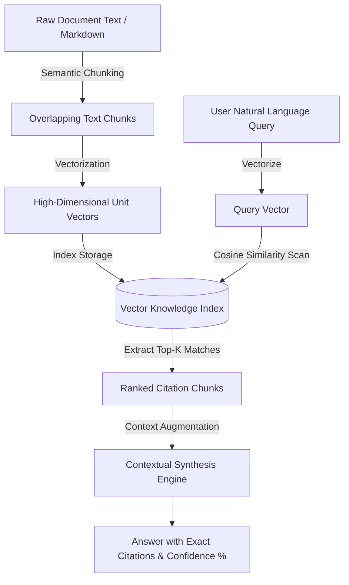

<div align="center">
  <h1>🧠 NeuroDoc AI</h1>
  <p><strong>Retrieval-Augmented Generation (RAG) Document Intelligence & Vector Knowledge Engine</strong></p>

  <p>
    <a href="https://github.com/Shahar-Yar095/neurodoc-ai/actions"></a>
    <a href="./LICENSE"></a>
    
    
    
  </p>
</div>

---

## 📌 Overview

**NeuroDoc AI** is a production-ready Retrieval-Augmented Generation (RAG) engine designed to ground contextual queries on verified domain documentation, preventing LLM hallucinations and delivering traceable citations.

Featuring an in-memory high-dimensional vector search index, dynamic text chunking with sentence overlap, cosine similarity scoring, and a modern reactive dashboard, NeuroDoc AI operates completely self-contained without requiring paid third-party API keys.

---

## 🚀 Key Features

- **✂️ Dynamic Semantic Chunking**: Segments unstructured documentation into overlapping text chunks to preserve local paragraph context.
- **📐 Cosine Vector Search**: Generates normalized frequency unit vectors for sub-millisecond similarity scoring.
- **🏷️ Source Citation Tracking**: Every synthesized response references the exact document title, chunk index, and semantic confidence percentage.
- **⚡ Interactive RAG Dashboard**: React + Vite UI featuring real-time knowledge base statistics, custom document ingestion, and quick-prompt chips.
- **🧪 Fully Tested**: Unit and integration test suite covering ingestion, vector distance algorithms, and query synthesis.
- **🤖 Zero External Dependencies**: Runs entirely local with native Node runtime—no OpenAI API key required to test or run.

---

## 🏗️ Architecture



---

## 📋 REST API Reference

| Method | Endpoint | Description |
| :--- | :--- | :--- |
| `GET` | `/api/health` | Server heartbeat, uptime, and vector index statistics |
| `POST` | `/api/query` | Submit query question (`question`, `topK`, `minScore`) |
| `GET` | `/api/documents` | Retrieve all indexed knowledge base documents |
| `POST` | `/api/documents` | Ingest new document (`title`, `content`, `category`) |
| `GET` | `/api/chunks` | Inspect raw vectorized chunks and preview text |

---

## ⚡ Quickstart

### 1. Clone & Run Backend Server
```bash
git clone https://github.com/Shahar-Yar095/neurodoc-ai.git
cd neurodoc-ai/server
npm install
npm run dev
```
Server starts on `http://localhost:4500`.

### 2. Run Frontend Dashboard
In a separate terminal:
```bash
cd neurodoc-ai/client
npm install
npm run dev
```
Open `http://localhost:3500` to interact with the RAG Knowledge Studio.

### 3. Run Automated Tests
```bash
cd neurodoc-ai/server
npm test
```

---

## 📄 License

Distributed under the **MIT License**. See [`LICENSE`](./LICENSE) for details.
